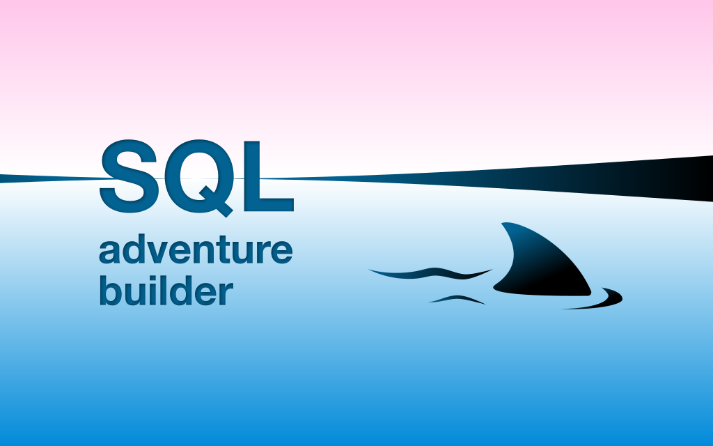

# SQLab Companion Repository for SQL Island Evolved

<p align="center">
  
</p>

<p align="center">
  <strong>SQLab, DuckDB, and DuckPGQ tooling for a graph-query learning adventure.</strong>
</p>

<p align="center">
  Forked from <a href="https://github.com/laowantong/sqlab">laowantong/sqlab</a>
</p>

<p align="center">
  
  
  
  
</p>

---

## Project Context

This repository accompanies the hosted term paper for the MSE Data Management SPR26 project:

**SQL Island Evolved: Mastery of Standardized Graph Queries through Play**

Hosted HedgeDoc version: <https://md.coredump.ch/s/zpSgBnx3G>

It contains the adapted SQLab tooling, DuckDB/DuckPGQ setup, and local development files used while writing and validating the paper. This repo preserves the implementation artifacts and the local reproducibility workflow behind the document.

The local Knowhere adventure is included as a working development copy under [`wd/knowhere`](wd/knowhere).

## Repository Contents

| Path | Purpose |
| - | - |
| [`sqlab/`](sqlab/) | Adapted SQLab framework code |
| [`wd/knowhere/`](wd/knowhere/) | Local Knowhere adventure used for development and documentation |
| [`wd/knowhere/ddl.sql`](wd/knowhere/ddl.sql) | DuckDB schema and property-graph declarations |
| [`wd/knowhere/dataset/`](wd/knowhere/dataset/) | TSV data loaded into the adventure database |
| [`wd/knowhere/output/`](wd/knowhere/output/) | Generated SQLab build output |
| [`wd/knowhere/web/`](wd/knowhere/web/) | Local browser UI prototype for the Knowhere adventure |
| [`Dockerfile`](Dockerfile) | Docker image for running the SQLab CLI |
| [`sqlab.sh`](sqlab.sh) | Convenience wrapper around the Docker command |

## Local Reproduction With SQLab CLI

The repository is designed around a Docker-first workflow. You do not need to install DuckDB, Python dependencies, or SQLab manually.

### 1. Build the image

Run this from the repository root:

```bash
docker build -t sqlab .
```

### 2. Create or rebuild the Knowhere adventure

From the repository root:

```bash
bash sqlab.sh wd/knowhere create
```

This reads the Knowhere configuration, applies the schema, loads the dataset, installs SQLab helper objects, compiles the adventure messages, and writes generated files into `wd/knowhere/output/`.

### 3. Open the SQLab shell

```bash
bash sqlab.sh wd/knowhere shell
```

Inside the CLI shell, open the first episode by entering the initial token:

```sql
42;
```

After that, the player reads the current mission, writes a SQL query, returns a `token` column, and SQLab decrypts the next episode when the token is correct.

## Direct Docker Commands

The wrapper script is only a convenience. The equivalent Docker commands are:

```bash
docker run --rm -it -v .:/workspace sqlab /workspace/wd/knowhere create
docker run --rm -it -v .:/workspace sqlab /workspace/wd/knowhere shell
```

The container entrypoint is:

```bash
python -m sqlab
```

The first argument passed to SQLab must be an adventure directory containing a `config.py`.

## Local Browser Version

The Knowhere folder also contains a local browser UI prototype:

```bash
cd wd/knowhere
docker compose up --build
```

Then open:

```text
http://localhost:8080
```

In the browser version, the first mission is displayed automatically. In the CLI version, the player enters `42` manually.

See [`wd/knowhere/README.md`](wd/knowhere/README.md) and [`wd/knowhere/web/ARCHITECTURE.md`](wd/knowhere/web/ARCHITECTURE.md) for details about the web setup.

## Knowhere Adventure Files

The Knowhere adventure uses DuckDB with the DuckPGQ extension to demonstrate SQL/PGQ-style graph queries. The graph tasks use concepts such as:

- `CREATE PROPERTY GRAPH`
- `GRAPH_TABLE`
- `MATCH`
- graph labels and edge labels
- edge properties such as trade cost
- path queries such as `ANY SHORTEST`
- recursive SQL for cost-based route search

Important local areas:

| Path | Purpose |
| - | - |
| `wd/knowhere/ddl.sql` | Tables and property graphs |
| `wd/knowhere/dataset/*.tsv` | Input data loaded by SQLab |
| `wd/knowhere/output/` | Generated SQLab output used for local inspection and the web prototype |

If the local adventure source files, schema, or dataset change, run:

```bash
bash sqlab.sh wd/knowhere create
```

to regenerate the output files.

## How Tokens Work

SQLab controls progression through tokens. A correct solution query returns a column named `token`. SQLab uses that value to decrypt the next message.

Example shape:

```sql
SELECT b.name,
       b.part,
       salt_042(sum(nn(b.hash)) OVER ()) AS token
FROM broker b;
```

The `salt_*`, `nn`, and `hash` pieces are part of SQLab's validation mechanism. They are not SQL/PGQ syntax.

## Adventure Directory Layout

A typical SQLab adventure folder looks like this:

```text
your-adventure/
├── config.py
├── cnx.ini
├── ddl.sql
├── records.json
├── dataset/
│   └── *.tsv
├── relational_schema/        # optional
└── output/                   # generated by `create`
```

Required files:

| File | Purpose |
| - | - |
| `config.py` | SQLab configuration for the adventure |
| `cnx.ini` | Connection settings for the target database |
| `ddl.sql` | Schema definition |
| `records.json` | Adventure structure and messages |
| `dataset/*.tsv` | Raw table data |

Even DuckDB adventures still need a `cnx.ini`. A minimal DuckDB example is:

```ini
[cnx]
database = knowhere.duckdb
```

## Main SQLab Commands

### `create`

Builds or rebuilds the database for an adventure:

```bash
bash sqlab.sh wd/knowhere create
```

This command typically:

- reads the adventure `config.py`
- creates the database
- applies `ddl.sql`
- loads data from `dataset/`
- installs SQLab helper tables and functions
- compiles messages from `records.json`
- writes generated files into `output/`

### `shell`

Opens the SQLab interactive shell:

```bash
bash sqlab.sh wd/knowhere shell
```

The shell adds two SQLab-specific conveniences:

- entering only a number calls `decrypt(...)`
- a `SELECT` returning a `token` column automatically decrypts the corresponding message

## Troubleshooting

### Port 8080 is already in use

The browser version uses port `8080`. Stop the other process or change the port mapping in [`wd/knowhere/docker-compose.yml`](wd/knowhere/docker-compose.yml).

### DuckPGQ fails to load in the web version

The web application tries to load or install DuckPGQ at startup and caches the extension in a Docker volume. If the first startup fails because of extension download issues, try running `docker compose up --build` again from `wd/knowhere`.

### Output files look stale

Regenerate the Knowhere output:

```bash
bash sqlab.sh wd/knowhere create
```

This is especially important after editing the local adventure source, `ddl.sql`, or files under `dataset/`.

## Included Local Examples

This repository contains local SQLab adventure folders under [`wd/`](wd/):

- [`wd/knowhere`](wd/knowhere)
- [`wd/sakila-adventure`](wd/sakila-adventure)

The Knowhere adventure is the one used by the term paper.

## Development Notes

- The Docker image installs dependencies with Poetry.
- `README.md`, `pyproject.toml`, and `poetry.lock` are copied early for better Docker layer caching.
- The container entrypoint is fixed to `python -m sqlab`.
- The project is based on SQLab but adapted for the Docker-first workflow used in this course project.
